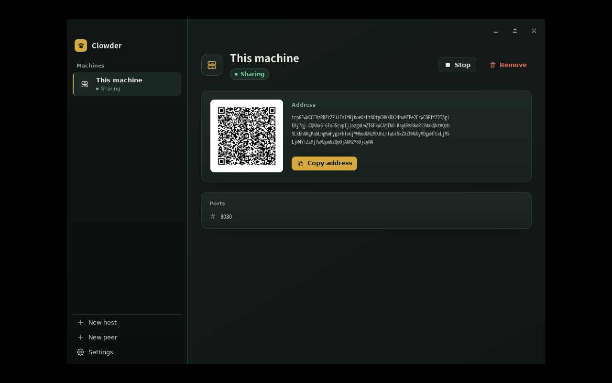
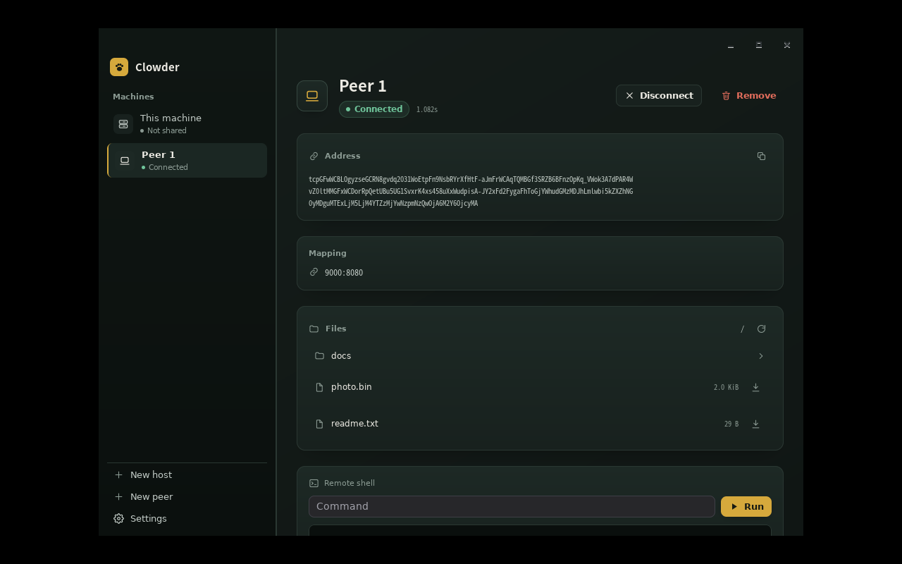
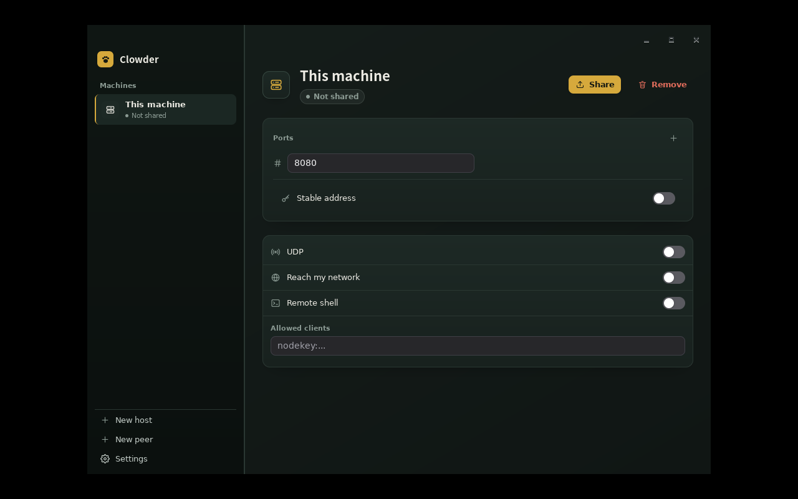
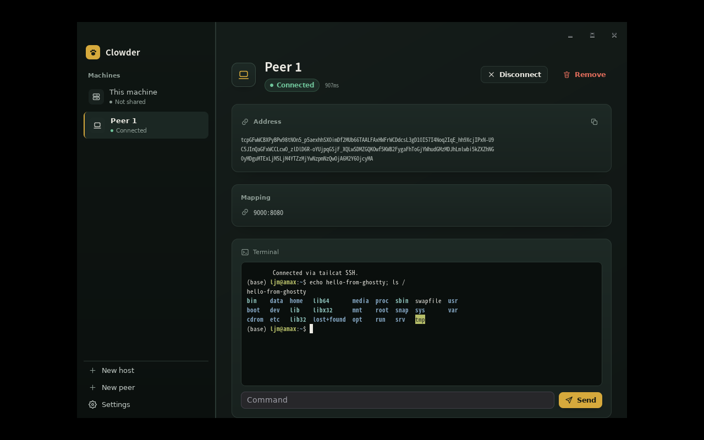
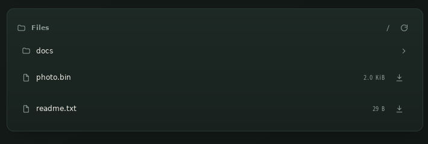
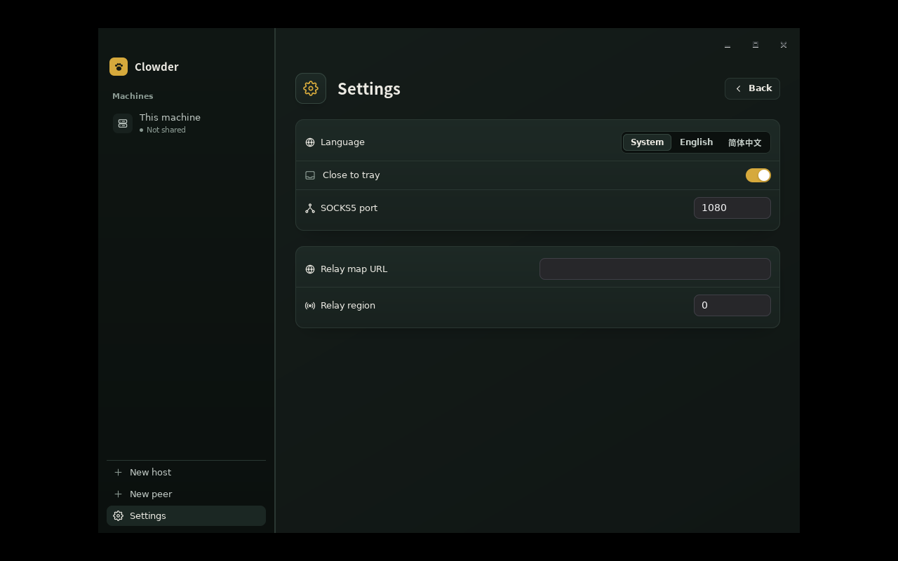

# Clowder

**Give a port to someone else, without a server, an account, or a firewall rule.**

Clowder is a small desktop app for reaching a service on another machine — a dev server, an SSH port, a file share — by handing over a short address or a QR code. It builds on [tailcat](https://github.com/tailscale/tailcat), Tailscale's own data plane without the control plane.



## Why it exists

The usual ways to expose a local port all ask for something: a public IP, a VPS to relay through, a hosted tunneling service with an account, or a VPN where every machine joins one network.

Clowder asks for none of that. Two machines agree on one address out of band, and the tunnel is up: WireGuard-encrypted, peer-to-peer when a direct path exists, relayed through a DERP server when it doesn't.

- **No account, no sign-in, no control plane.** Nothing to register, nobody in the middle deciding who can connect.
- **No root, no TUN device.** Everything runs in userspace.
- **The address is the secret.** It carries the public key and the pre-shared key; whoever has it can connect.
- **Ephemeral by default.** Every session gets a new address; stop sharing and it's dead.

## Install

Download the package for your platform from [Releases](https://github.com/AndPuQing/clowder/releases).

| Platform | File | Before you run it |
|---|---|---|
| macOS (Apple Silicon) | `clowder-darwin-arm64.zip` | Unzip, drag `Clowder.app` into Applications |
| macOS (Intel) | `clowder-darwin-amd64.zip` | Same |
| Windows | `clowder-windows-amd64.zip` | WebView2 runtime (included in Windows 11) |
| Linux | `clowder-linux-amd64.tar.gz` | `libgtk-3-0`, `libwebkit2gtk-4.1-0`, `libayatana-appindicator3-1` |

The macOS builds are not signed or notarized. The first launch is blocked by Gatekeeper: right-click the app, then choose **Open**.

Linux:

```sh
sudo apt install libgtk-3-0 libwebkit2gtk-4.1-0 libayatana-appindicator3-1
tar -xzf clowder-linux-amd64.tar.gz
./clowder
```

## Use it

**On the machine with the service** (the host):

1. Pick the machine on the left, and add the ports you want to share, for example `8080` or `8080=127.0.0.1:8080`.
2. Press **Share**. Clowder shows a QR code and an address.
3. Hand them to the other person — scan the code, or copy the address.

**On the machine that needs it** (the peer):

1. Press **Connect to a peer** in the left column to add a peer.
2. Paste the address, choose the mapping (`9000:8080` means "make it available on my 9000").
3. Press **Connect**, then open `http://127.0.0.1:9000`.





Manages as many machines as you like — each one keeps its own state and its own tunnel. Click a machine's name in the detail pane to rename it; the rail updates as you type.

## Beyond plain port sharing

Each machine has a few switches under its ports:

| Switch | What it does |
|---|---|
| **Stable address** | Keep the same address across restarts (saved key instead of an ephemeral one) |
| **Forward UDP too** | Relay UDP on the same port — game servers, DNS, WebRTC signalling |
| **Let the peer reach my network** | The peer can dial *any* address this machine can reach, not just the ports you listed |
| **Only these client keys** | Refuse everyone except the client public keys you paste in |
| **Share files (read-only)** | Expose one directory over SFTP, read-only, for the peer to browse |

On the connecting side there are two more:

| Switch | What it does |
|---|---|
| **Forward UDP too** | Relay UDP as well, on the same local port |
| **Local SOCKS5 proxy** | Opens `127.0.0.1:1080`; every connection through it is carried by the tunnel to the host, which dials it on your behalf |
| **Browse the host's files** | Lists the host's shared directory; click a file to download it to `~/Downloads/Clowder/<device>/` |

That last pair is how you reach a machine's whole LAN: the host allows it, the peer points a browser or `curl` at the local SOCKS5 port.

Each peer shows its own public key. Paste that key into the host's **Only these client keys** field to pin the connection: the peer's key is saved per device, so it survives restarts. Entries can be space- or comma-separated, and a `nodekey:` prefix is fine.

```sh
curl --socks5-hostname 127.0.0.1:1080 http://192.168.1.20:8080/
curl --socks5-hostname 127.0.0.1:1080 https://internal.example/
```

The tunnel carries the bytes; the host does the routing.

> The interface follows your system language: English and Simplified Chinese are included.

## Remote shell

Turn on **Allow remote shell (SSH)** for a machine. After you connect to it as a peer, a **Remote shell** panel appears: type a command, press **Run**, and the host runs it and sends back the output.

No `sshd` to configure, no port 22 to map, no `ssh` client to install — the session runs over the same encrypted tunnel, and tailcat's built-in SSH server handles the shell. The host's SSH host key is generated on first use under `~/.config/tailcat/ssh`.

### Interactive terminal (build-time option)

The peer can also open a real interactive terminal: the session is parsed by
[libghostty-vt](https://github.com/ghostty-org/ghostty), Ghostty's terminal core,
and drawn cell by cell by the app — colours, bold, italic and the cursor block
included. There is no PTY on your machine and no terminal emulator to install on
the host: the bytes travel over the tunnel and end up in Ghostty's emulation.

This needs the library at build time, so released binaries do not include it yet:

```sh
just ghostty-lib     # build libghostty-vt once (needs Zig 0.17.1)
just build-ghostty   # the app with the terminal
```

The plain Go route is documented in [`docs/GHOSTTY.md`](docs/GHOSTTY.md).

The terminal appears for a peer once **Open interactive terminal** is on and the
connection is up. Click it and type: keys, arrows, Ctrl combinations and the
function keys go straight to the remote shell. The **Send** line below is a
fallback for pasting a whole command.



### Shared files

Turn on **Allow remote shell (SSH)** and then **Share files (read-only)**, and pick a directory. The peer turns on **Browse the host's files** before connecting: the panel lists the directory, and clicking a file downloads it into `~/Downloads/Clowder/<device>/`. Nothing is mounted and nothing is writable; the SFTP session runs inside the same tunnel as everything else.



## Settings



- **Language** — follow the system, or pin English or Simplified Chinese
- **Hide to tray when the window closes** — off means closing the window quits
- **Local SOCKS5 port** — where the peer-side proxy listens (default 1080)
- **DERP map URL** — point at your own relay list instead of the public one
- **Preferred relay region ID** — pin a region instead of picking the nearest

Changes to the relay settings apply to the next connection you start.

## It keeps running when you close the window

Closing the window hides Clowder to the tray; the tunnels stay up. The tray menu shows every machine and its state, and lets you start or stop each one without reopening the window. **Quit** from the tray to exit for real.

On Linux the tray needs `libayatana-appindicator3`. Without it, Clowder falls back to quitting when you close the window, rather than hiding with no way back.

## What's in the address

A Clowder address (`tc…`) is a compact base64url blob holding the host's WireGuard public key, a path-discovery key, an optional pre-shared key, and the DERP region to bootstrap through. DERP is only used to introduce the two sides and to relay when a direct path can't be found; once both sides learn each other's endpoints, traffic goes direct.

Because the address *is* the credential, treat it like a password for the duration of the pass.

## Command line

The same engine ships as `clowderd`, for headless machines and scripts:

```sh
# share this machine's 8080
clowderd serve -expose 8080

# share TCP and UDP, let the peer reach the whole network
clowderd serve -expose 8080 -udp -allow-proxy

# only these clients may connect
clowderd serve -expose 8080 -allow nodekey:abc123...

# reach someone else's 8080 on your local 9000, plus a SOCKS5 proxy
clowderd dial -addr tcXXXX -forward 9000:8080 -udp -socks 127.0.0.1:1080

# share a directory read-only over SFTP
clowderd serve -expose 8080 -ssh -ssh-files ~/project

# list and download files from a host that shares a directory
clowderd files -addr tcXXXX -list /
clowderd files -addr tcXXXX -get /notes.md -out ./notes.md

# keep an address stable across restarts
clowderd serve -expose 8080 -key my-node
clowderd keys list
```

## Building from source

With [just](https://github.com/casey/just):

```sh
just                 # build clowder and clowderd into bin/
just check           # gofmt, go vet, tests
just e2e             # tunnel a local HTTP file through DERP (needs network)
just build-ghostty   # the app with the interactive terminal (see docs/GHOSTTY.md)
just doctor          # check the local toolchain before building
```

Plain Go works too:

```sh
go build -o clowder ./cmd/clowder      # the app
go build -o clowderd ./cmd/clowderd    # the command line tool
```

This machine keeps its Go toolchain outside `PATH`; `source scripts/env.sh` points at it, and the justfile does the same. On Linux the app loads GTK 3 at runtime (`libgtk-3-0`); WebKitGTK and the Ayatana appindicator are used when present (web view and tray). Releases are built natively on GitHub Actions for each platform — see [`.github/workflows/release.yml`](.github/workflows/release.yml). There is a container setup for Linux GUI work in [`dev/`](dev/).

## Design

The interface is built from a small set of surfaces and one SVG icon set. The
binding rules — including *the interface does not explain itself* — are in
[`docs/UI.md`](docs/UI.md).

## License

MIT — see [LICENSE](LICENSE).
